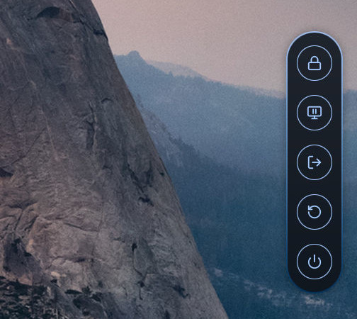

# ML4W Power Menu

A power menu for Hyprland built with [Quickshell](https://quickshell.org). It
slides in from the right edge of the screen with buttons to lock the screen,
suspend, log out, reboot and power off. Part of
[ML4W OS](https://github.com/mylinuxforwork/dotfiles), but it also runs on its own.



## Installation

```bash
curl -sSL https://raw.githubusercontent.com/mylinuxforwork/ml4w-powermenu/main/install.sh | bash
```

The script clones ml4w-powermenu into `$HOME/.local/share/ml4w-powermenu`, or
pulls the latest version if the folder already exists, and links the
`ml4w-powermenu` command into `$HOME/.local/bin`. Run it again to update.

Requires `git` and `quickshell`.

`$HOME/.local/bin` must be in your `$PATH` to run `ml4w-powermenu`. Most
distributions add it by default. If yours does not, add this line to your shell
configuration (e.g. `~/.bashrc` or `~/.zshrc`):

```bash
export PATH="$HOME/.local/bin:$PATH"
```

## Start

```bash
ml4w-powermenu
```

This runs `qs -p ~/.local/share/ml4w-powermenu`. The menu stays hidden until it
is opened. If it is already running, nothing happens. `ml4w-powermenu stop` stops it and `ml4w-powermenu restart`
restarts it.

To start it with Hyprland, add this line to your Hyprland config (the ML4W
Dotfiles start it from `ml4w-autostart`):

```
hl.on("hyprland.start", function ()
  hl.exec_cmd("~/.local/bin/ml4w-powermenu")
end)
```

To open the menu with a key, bind `ml4w-powermenu toggle`, e.g.:

```
hl.bind("SUPER + CTRL + P", hl.dsp.exec_cmd("ml4w-powermenu toggle"))
```

Use the arrow keys and Enter to pick a button, Escape or a click outside to
close the menu.

The menu brings its own slide animation. To keep Hyprland's layer animation
from playing on top of it, add this rule to your Hyprland config (the ML4W
Dotfiles already include it):

```
hl.layer_rule({ match = { namespace = "ml4w-powermenu" }, no_anim = true })
```

## IPC

```bash
ml4w-powermenu <function>
```

This is a shortcut for `qs -p ~/.local/share/ml4w-powermenu ipc call power <function>`.

| Function | Description |
|---|---|
| `toggle` / `open` / `close` | Show or hide the power menu |
| `reload` | Re-read `config.json` and apply it |
| `edit` | Open `config.json` in the configured editor |

Run `ml4w-powermenu help` to list all commands.

## Configuration

The power menu reads `~/.config/ml4w-powermenu/config.json`. It is created on
first start and merged over the built-in defaults, so it only needs the values
you want to change. The file is watched, so changes apply as soon as you save
it. [`PowerApp/config.json`](PowerApp/config.json) lists every setting with its
default value.

- `powermenu.order` lists the buttons from top to bottom. The available buttons
  are `lock`, `suspend`, `logout`, `reboot` and `poweroff`. Leave one out to
  hide it.
- `commands.<button>` is what the button runs. The defaults call the ML4W
  `ml4w-power` script; without the ML4W Dotfiles, set your own commands, e.g.:

  ```json
  {
      "powermenu": { "order": ["lock", "logout", "poweroff"] },
      "commands": {
          "lock": "pidof hyprlock || hyprlock",
          "logout": "hyprctl dispatch 'hl.dsp.exit()'",
          "poweroff": "systemctl poweroff"
      }
  }
  ```

- `powermenu.editorCommand` opens `config.json` (`ml4w-powermenu edit`). The
  file path is appended as the last argument. If the command is empty or its
  program is not found, `xdg-open` is used.
- `button`, `pill`, `border` and `opacity` set the size, spacing, shape,
  animation and transparency of the menu.
- `theme.colorsFile` is a JSON file of Material color roles (matugen's
  `colors.json` format). The power menu watches it and recolors when it changes.
- `theme.opacityFile` is a plain file holding a background opacity in percent
  (0-100), shared with the rest of the ML4W shell. While it holds a number it
  overrides `opacity.normal`. Set it to `""` to always use `opacity.normal`.
- `theme.transparentBorderFile` holds `on` or `off`. On (also when the file is
  missing): the border fades with the background. Off: it stays at 80%.
- `theme.blurFile` holds `on` or `off` (ML4W's Blur switch). While it is `on`
  the drop shadow is hidden, because the compositor blur would end in a hard
  edge around it.

All commands are run through bash, so `~`, arguments and pipes work.

## Wallpaper colors with matugen

To make the power menu follow your wallpaper, have
[matugen](https://github.com/InioX/matugen) write its colors to
`theme.colorsFile`. Add a template to `~/.config/matugen/config.toml`:

```toml
[templates.ml4w_powermenu]
input_path  = "./templates/colors.json"
output_path = "~/.config/ml4w-powermenu/colors.json"
```

`templates/colors.json` maps each Material color role to its matugen value, e.g.
`"primary": "{{colors.primary.default.hex}}"`. The power menu watches the file,
so no `post_hook` is needed. ML4W OS ships a complete
[config and template](https://github.com/mylinuxforwork/dotfiles/tree/main/dotfiles/.config/matugen).

## Uninstall

```bash
curl -sSL https://raw.githubusercontent.com/mylinuxforwork/ml4w-powermenu/main/uninstall.sh | bash
```

Stops the power menu and removes `$HOME/.local/share/ml4w-powermenu` and the
`ml4w-powermenu` command in `$HOME/.local/bin`. Your configuration in
`~/.config/ml4w-powermenu` is kept.
